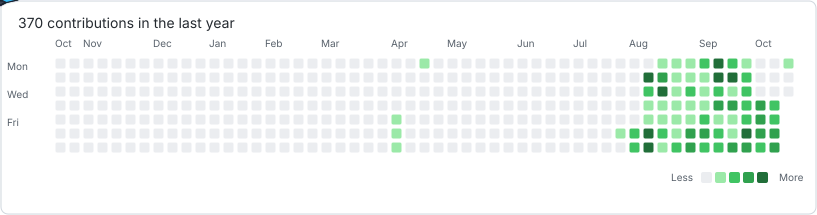

# MOHAMMED MAAZ

**AI & Cloud Engineer** · CSE (AI/ML)

*Think deeply. Build simply. Ship consistently.*

 

---

### Selected work

| | |
|---|---|
| **[Compute Control Plane](https://github.com/MohammedMaaz06/compute-control-plane)** | Go orchestration platform for container lifecycle, persistence and telemetry |
| **[MCP Ops Assistant](https://github.com/MohammedMaaz06/REPO-NAME)** | Multi-agent ops assistant built on LangGraph and MCP tools |
| **[HealOps AI](https://github.com/MohammedMaaz06/REPO-NAME)** | Self-healing Kubernetes infrastructure driven by AI analysis |

---

