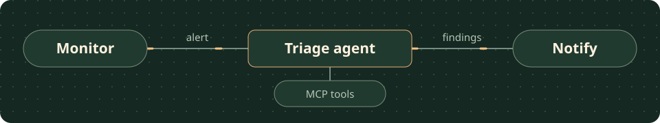

  <a href="#selected-work">Selected work</a> &nbsp;·&nbsp;
  <a href="#toolkit">Toolkit</a> &nbsp;·&nbsp;
  <a href="https://mohammedmaazkara.vercel.app/">Portfolio ↗</a> &nbsp;·&nbsp;
  <a href="https://www.linkedin.com/in/mohammed-maaz-6129b2219">LinkedIn ↗</a>

I’m **Mohammed Maaz**, a final-year Computer Science student specializing in AI and machine learning in Bhatkal, India. I like engineering questions that fit in one sentence but take a working system to answer. One I’m exploring now: **when an infrastructure alert arrives, what does an agent need to know before it wakes someone up?**

## Selected work

### MCP Ops Assistant

An incident-response assistant built around that question. Monitoring picks up an alert, a triage agent gathers context through MCP tools, and a notification carries the findings forward. LangGraph coordinates the handoffs.

**Built with** · Python · FastAPI · LangGraph · Model Context Protocol

<table>
<tr>
<td width="50%" valign="top">

### HealOps AI

How much of an infrastructure investigation can an agent help with? I’m exploring incident analysis and the operational tasks that follow it.

**Focus** · Cloud operations and automation

</td>
<td width="50%" valign="top">

### AI Interview Coach

A full-stack practice space for developers preparing for technical interviews. It brings AI-assisted practice into the preparation process.

**Focus** · Python and applied AI

</td>
</tr>
</table>

## Toolkit

| Area | Technologies |
| :--- | :--- |
| Languages | Python, Go, TypeScript, JavaScript, SQL |
| AI & machine learning | LangGraph, LangChain, OpenAI, machine learning, deep learning |
| Backend & frontend | FastAPI, Node.js, Express, React, Next.js |
| Cloud & delivery | Docker, Kubernetes, Linux, GitHub Actions |
| Data & tools | PostgreSQL, MongoDB, Redis, Git, GitHub |

## Engineering notes

The part I enjoy most is finding where a design meets reality. In an agent workflow, that can be one small handoff: what did the monitoring agent see, what context is missing, and what should the next agent receive? Making that handoff clear is often where the system starts to make sense.

[Explore my repositories](https://github.com/MohammedMaaz06?tab=repositories) · [View my GitHub activity](https://github.com/MohammedMaaz06#year-list-container) · [Connect on LinkedIn](https://www.linkedin.com/in/mohammed-maaz-6129b2219)
