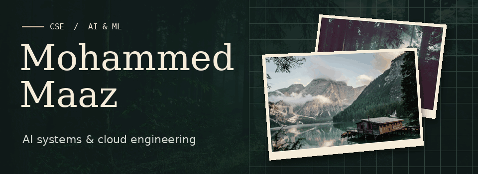

  <a href="https://mohammedmaazkara.vercel.app/"><strong>Portfolio ↗</strong></a>
  &nbsp; · &nbsp;
  <a href="https://www.linkedin.com/in/mohammed-maaz-6129b2219"><strong>LinkedIn ↗</strong></a>

## Engineering interests

<table>
<tr>
<td width="50%" valign="top">

**Agentic AI**

I build Python workflows that let agents call tools and pass work between them.

<code>LangGraph</code> <code>MCP</code> <code>FastAPI</code>

</td>
<td width="50%" valign="top">

**Cloud infrastructure**

I work with containerized services and explore how they communicate and recover from failures.

<code>Go</code> <code>Docker</code> <code>Kubernetes</code>

</td>
</tr>
</table>

## On my workbench

**MCP Ops Assistant** · My incident-response project connects monitoring, triage, and notification through a LangGraph workflow. I use MCP to give the agents access to operational tools.

**AI Interview Coach** · A practice space for developers preparing for technical interviews, built with Python and a web interface.
